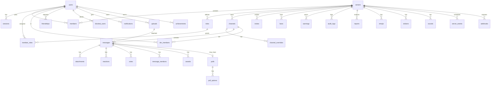

# Architecture

> Boring internals. Unhinged exterior. One container.

AISlopMemeCord is a single Bun process with a layered TypeScript backend, a hand-built Preact SPA and a separate
admin SPA. SQLite and all files live under `SLOP_DATA_DIR` (default `/data` in Docker). There are no external
services, workers, queues or background daemons.

## Goals & non-goals

**Goals**

- One container, one exposed port, zero-config startup.
- Fully functional core chat platform, not a demo shell.
- All persistent state in one directory; portable, backup-able, inspectable.
- Small dependency surface; easy for a human to read and modify.
- Privacy by default: no telemetry, no external requests, local auth, E2EE available.
- Tests that exercise real HTTP, WebSocket, SQLite and filesystem behavior.

**Non-goals**

- Horizontal scaling / federation / multi-node. SQLite + in-memory presence intentionally anchor this to one process.
- Native mobile or desktop apps. The web app is responsive and self-contained.
- Bot SDKs, marketplace, monetization, Nitro-style cosmetics.
- Third-party "AI" integrations. The slop is generated locally with deterministic nonsense.

## Process model

```
bun run src/server/index.ts
  ├─ loadConfig()                env → resolved paths, secret, limits
  ├─ openDatabase()              WAL, foreign_keys, migrations
  ├─ seedIfEmpty()               global sound assets (demo)
  ├─ seedDemoForAdmin()          on first registration only
  └─ Bun.serve()
       ├─ fetch(req, server)
       │    ├─ /api/gateway → WebSocket upgrade
       │    ├─ /api/*       → Router → auth → CSRF/limits → handler
       │    ├─ /static/*    → built assets
       │    ├─ /admin*      → admin.html
       │    └─ *            → index.html (SPA fallback)
       └─ websocket handlers (Hub events, heartbeats, voice signaling)
```

Everything is synchronous SQLite except password hashing, upload streams and WebRTC signaling; Bun handles
concurrency across requests. The app is designed for hundreds to low thousands of users, not millions.

## Backend layers

```
routes/        HTTP endpoints: validation, permissions, status codes, broadcast orchestration
services/      business logic: permissions, messages, auth, seed, uploads, invites, moderation, voice…
repos/         row → DTO mapping, batched serialization, SQL query helpers
db/            connection wrapper + SQL migrations
realtime/hub   WebSocket connection registry, presence, audience filtering, voice participant state
util/          IDs, crypto, validation, logging
shared/        types, permission constants, achievement/award data shared by client & server
```

Rule of thumb: **routes should be thin**, services own invariants, repos own SQL shape and DTO assembly.
Cross-cutting failures use `ApiError(status, CODE, message)` so the HTTP envelope is uniform:

```json
{ "error": "MISSING_PERMISSIONS", "message": "You lack the required permission. The audacity.", "fields": {} }
```

Validation throws `ValidationError`, serialized with status 400 and per-field messages.

## Request pipeline

1. **Security headers** attached to every response (CSP, nosniff, frame deny, referrer policy, permissions policy).
2. **IP resolution** honoring `SLOP_TRUST_PROXY` if configured.
3. **Rate limiting** global per-IP plus optional per-route buckets (login, uploads, invites, voice, etc.).
4. **Session resolution** from the HttpOnly `slop_session` cookie. Expired sessions are deleted; sliding activity
   extends the expiry.
5. **Origin check** on mutating requests, then **CSRF double-submit** (`slop_csrf` cookie vs `X-CSRF-Token`).
6. **Route auth/admin gates** from route options (`auth: false`, `admin: true`).
7. **Handler** validates input, checks server/channel permissions, mutates DB in a transaction when needed,
   returns a JSON DTO and broadcasts realtime events.
8. **Logging** of slow requests and errors (never secrets/passwords/tokens).

WebSocket upgrades resolve the same session cookie before `server.upgrade`.

## Data model

SQLite (WAL) at `${SLOP_DATA_DIR}/slop.db`. Migrations are ordered SQL files in `src/server/db/migrations/`,
tracked with `PRAGMA user_version`, applied in a transaction on startup.



Notable tables:

- `messages_fts` is an FTS5 table with triggers syncing non-encrypted message content. Encrypted messages are excluded.
- `uploads` tracks every file with owner, purpose, MIME, size, hash, dimensions and optional attached message.
- `attachments` denormalizes message attachment metadata for fast serialization.
- `message_mentions` powers notification/mention counts and channel mentions.
- `read_states` stores per-user/channel last-read cursor and cached mention counts.
- `settings` is a JSON key/value store for instance settings; secrets are not stored there.
- `audit_logs` stores actor, action, target, reason and JSON changes for every server/admin action.

### IDs and timestamps

IDs are prefixed, lexicographically sortable strings: `<type>_<base36-time><counter><random>`. Timestamps are epoch
milliseconds everywhere. Message pagination uses ID ordering, which matches insertion order even within a millisecond.

## Permissions

Discord-style 32-bit permission bitfield (`src/shared/permissions.ts`). Computation for a guild channel:

```
base = @everyone.permissions OR all member role permissions
if owner or ADMINISTRATOR → allow
apply category overrides (everyone → role aggregate denies/allows → member)
apply parent channel overrides (threads)
apply channel overrides (same order)
final = (base & ~deny) | allow
```

Owner and instance-admin bypasses are explicit. Channel overrides request validation prevents privilege escalation
(you cannot grant permissions you do not have). Role edits enforce hierarchy: no assigning/removing roles at or above
your highest role unless owner. The same logic is mirrored approximately in the client only for **UI gating**;
server-side checks are authoritative.

DM visibility is membership in `dm_members`, not a permission bitfield. Non-members receive 404 to avoid existence leaks.

## Realtime gateway

`src/server/realtime/hub.ts` maintains:

- connection registry (`connId → ws`, `userId → connections`) for multi-tab support;
- presence derived from live connections + the user's chosen status (invisible shows offline);
- channel audience cache (5s) used to filter broadcasts to users who can actually view a channel;
- voice participant maps per channel;
- targeted sends for DMs, notifications and friend updates.

Events use a compact envelope:

```json
{ "op": "dispatch", "t": "MESSAGE_CREATE", "d": { "message": { "...": "..." } } }
```

Handshake: server sends `hello` (heartbeat interval), then `READY` (user, joined server IDs, unread cursors,
instance info). Clients send heartbeats; stale connections are swept after 75 seconds.

**Privacy guard:** messages are never broadcast to every connection. `broadcastChannel` builds an audience of
online users who pass channel view checks (DM membership or computed guild permissions) and sends only to them.

## Message pipeline

1. `channelForUser` resolves the channel and view permission.
2. Send permission (text vs thread), locked/archived checks, timeout/ban status, slowmode throttle.
3. Body validation: content length, nonce idempotency, reply target in same channel, attachment ownership and limits,
   custom emoji existence/entitlement, poll shape, sticker ownership, encryption only in DMs.
4. Insert within a transaction; attach uploaded files; create poll/options; parse and store mentions.
5. Update `channels.last_message_id` and author read state; grant achievements; create notifications for mentions
   and replies; bump mention counts.
6. Serialize the full message DTO in batches (authors, replies, attachments, reactions, votes, polls, awards, saved
   state) and broadcast to the computed audience.

Edits, deletes, pins, reactions, votes and poll votes follow the same pattern. Vote deltas update both the
message score and author karma atomically; deletion subtracts the deleted score from karma.

## Auth & sessions

- Registration creates an Argon2id hash (`Bun.password`), stores no email.
- First registered user is instance admin.
- Session token is random, 32 bytes base64url; only its SHA-256 is stored.
- HttpOnly cookie, SameSite=Lax, optional Secure. 30-day sliding expiry.
- Login attempts are throttled per IP with a short-lived DB counter; generic error messages avoid username enumeration.
- Optional TOTP (RFC 6238) implemented with Node crypto; secret stored on the user; no recovery codes.
- CSRF is double-submit with an origin check; webhook endpoints are unauthenticated by design but token-verified.
- Sessions are listable/revocable; password change revokes all other sessions.

## Media & uploads

- Multipart uploads are parsed by Bun, size-capped per purpose.
- MIME is sniffed from magic bytes, not the client-provided type. HTML/JS is rejected. SVG is allowed for emoji only
  and sanitized aggressively (scripts, event handlers, foreignObject, external URLs, CSS URLs).
- Files are stored under `uploads/YYYY/MM/<id>.<ext>` with random names; paths are DB-only, never user-supplied.
- Images get dimensions parsed for nicer layout. SHA-256 is stored for dedupe/debug.
- Serving is permission-aware: pending uploads only visible to owner; attachments require channel visibility;
  profile/emoji/sticker/sound media requires authentication; admin uploads are not publicly served.
- ETag and byte-range support for media; `nosniff`; SVG served with a sandbox CSP.

## Client architecture

```
src/client/
  main.tsx               SPA entry; boots store, gateway, router
  views/                 Auth landing, ChatApp, ChannelView, Home, Friends, Discover, Saved, Leaderboard…
  components/            primitives (icons, avatar, modal/menu/toasts), messages/composer, sidebars, modals
  lib/
    api.ts               fetch wrapper, errors, CSRF, upload
    gateway.ts           WebSocket client with reconnect + heartbeats
    store.ts             observable app state + actions
    store-realtime.ts    gateway event reducers
    permissions.ts       client-side permission mirror for UI gating
    markdown.tsx         safe Markdown → VNodes (no HTML injection)
    e2ee.ts              WebCrypto ECDH + AES-GCM helpers
    voice.ts             WebRTC mesh manager
  styles/                design tokens, components, app shell, chat, landing, settings, admin
```

All state lives in a single observable store. Components subscribe and re-render on change; selectors are computed
from the store. Routing is History API based (`/channels/:serverId/:channelId`, `/channels/@me/:dmId`, `/friends`, …).
The client never trusts its own permission mirror; it reflects UX only.

**Markdown is rendered to VNodes by a custom parser.** No `dangerouslySetInnerHTML`, no external link previews, no
image fetches except same-origin `/static`, `/api/media`, or `/api/attachments`. Links get `rel=noopener noreferrer`.

## E2EE design (1:1 DMs)

1. On first authenticated boot the browser generates an ECDH P-256 keypair with WebCrypto.
2. The private JWK stays in `localStorage`; only `{kty,crv,x,y}` is uploaded to the user's `public_key`.
3. Sender derives AES-256-GCM with ECDH(sender private, recipient public), generates a random 12-byte IV and encrypts.
4. Server stores base64 ciphertext in `messages.content`, sets `encrypted=1`, and stores `{v,iv}` in `crypto_meta`.
   Search excludes encrypted rows; admins see only ciphertext.
5. Recipient derives the same key with their private key + sender public key and decrypts in the browser.

Limitations: static keys (no ratchet/forward secrecy), private key bound to one browser, no group E2EE, no key
verification UI yet, and message content still lives in the sender/receiver's local storage/browser caches. If a
key is lost, old ciphertext is unrecoverable by design. These are documented honestly in [PRIVACY.md](PRIVACY.md).

## Voice design

Voice channels use a full-mesh WebRTC topology for up to 12 participants. The server only relays signaling blobs
(no audio). The joining participant initiates offers to existing peers; existing peers answer. ICE candidates are
queued until remote descriptions are set. Speaking detection uses a local analyser and a throttled state event.
Soundboard events send a same-origin URL to all voice participants and play locally.

No STUN server is configured by default for privacy/zero-config. This means voice works best on a LAN or directly
reachable host. Operators can set `SLOP_STUN_URLS`; TURN is not included. This is a deliberate trade-off, not a bug.

## Admin separation

`/admin` serves a separate HTML/JS bundle with a corporate theme. It shares the session cookie but requires
`is_admin` on every API route (`/api/admin/*`). Instance admins bypass guild permissions for management/viewing
reported content, but encrypted DMs remain ciphertext and private keys are never accessible. Last-admin safety
rails prevent locking the instance out. All admin writes are audited globally.

## Seeding

- Startup seeds global soundboard clips (only when `SLOP_DEMO_SEED` is enabled).
- The first registered user gets a complete demo world: users, server, categories, channels, roles, messages,
  reactions, votes, awards, poll, forum posts, DMs, friends, notifications, events, invite, reports and audit rows.
- Seeding is idempotent per admin/owner; it never runs for later registrations.

## Testing

Tests live in `tests/integration` and run against a real `Bun.serve` on an ephemeral port with a temp data dir.
Helpers provide cookie-aware API clients, user factories, server factories and a WebSocket buffer-aware waiter.
The suite covers auth, permissions, realtime, media, search, seed, voice and admin safety rails. See
[DEVELOPMENT.md](DEVELOPMENT.md).

## Known trade-offs

- **Single process / single instance** by design. SQLite WAL + in-memory presence do not support horizontal scaling
  without a redesign; that is a feature for a self-hosted community instance.
- **No external link previews** to avoid SSRF/privacy leaks. Links are plain anchors.
- **Static E2EE keys** trade forward secrecy for zero-setup usability and no server-side key escrow.
- **Full page reload after login** rather than a delicate client session dance; boring and reliable.
- **Seed passwords are intentionally unusable**; demo users are decorative, not login accounts.
- **Client permission mirror** can lag after role changes until server refresh, but server enforcement is real.
