# Feature tour

> Everything below is implemented and exercised by the integration suite or a real browser smoke test. Limits are
> listed honestly at the end instead of hidden behind "coming soon".

## At a glance

| Area | Status | Notes |
|---|---|---|
| Servers, categories, channels | Working | Text, voice, forum, announcement, threads |
| Discord-style permissions | Working | Role bits, @everyone, channel overrides, hierarchy |
| Messages | Working | Markdown, replies, edits, deletes, pins, attachments, spoilers, mentions |
| Reactions, votes, awards | Working | Unicode + custom emoji, Slop Points, award badges |
| Polls | Working | Single/multiple choice, timed close, aggregate results |
| Forums and threads | Working | Tags, hot/new/top, posts, replies, archive/lock |
| Full-text search | Working | FTS5, permission-safe, channel/server/all scopes, operators |
| DMs and friends | Working | 1:1, group, requests, blocks, unread state |
| E2EE | Working, limited | 1:1 DMs only; static ECDH keys; no group E2EE |
| Voice | Working, limited | WebRTC mesh + soundboard; no TURN, recording, screen share or DM calls |
| Moderation | Working | Kick, ban, timeout, warnings, purge, reports, audit |
| Admin console | Working | Separate `/admin` SPA for instance management |
| Privacy controls | Working | 2FA, session revoke, export, hard delete, E2EE key backup |
| Themes and accessibility | Working | Five themes, compact mode, large text, reduced motion |

## Landing and account creation

No email, no phone, no OAuth. Pick a username and password. The first account on a fresh instance becomes the
instance admin. If demo seeding is enabled, that first admin receives **The Slop Pit**, a complete demo server.

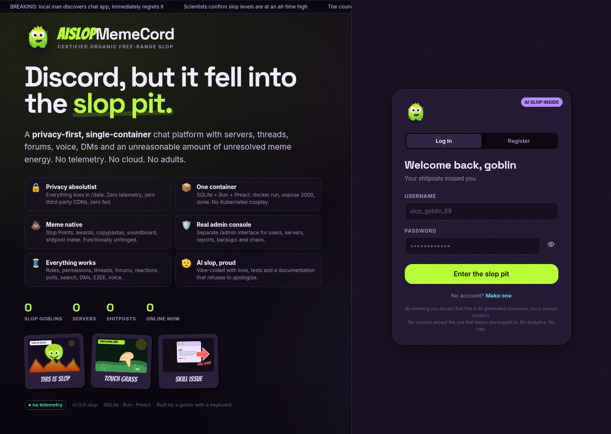

The landing page is also the login and registration surface. Account invites appear here when the instance is in
invite-only mode.

## Home, friends and discovery

The home view shows your servers, unread state, friend requests, Slop of the Day and the current meme ticker.
Discovery lists public servers with join buttons; there is no ranking algorithm or promoted placement.

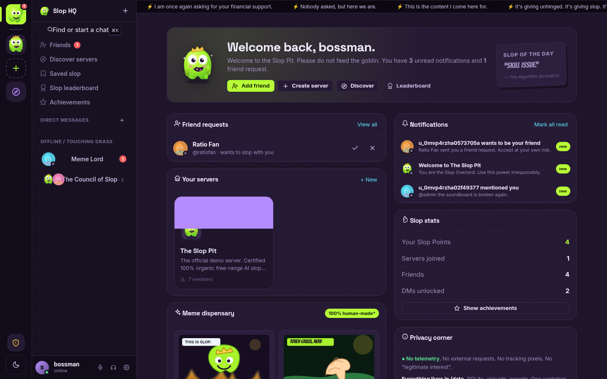

| Page | What it does |
|---|---|
| Friends | Search users, send/accept/decline requests, block, DM |
| Discover servers | Browse and join public servers |
| Saved slop | Messages you bookmarked |
| Slop leaderboard | Karma and Slop Points for the week/month/all time |
| Achievements | Founder, first message, votes, awards, voice minutes, and other nonsense |

## Servers and channels

Servers have a name, icon, banner, description, MOTD, traits, public/private visibility, owner and member count.
Channels are grouped into categories and can be text, voice, forum, announcement, thread or category.

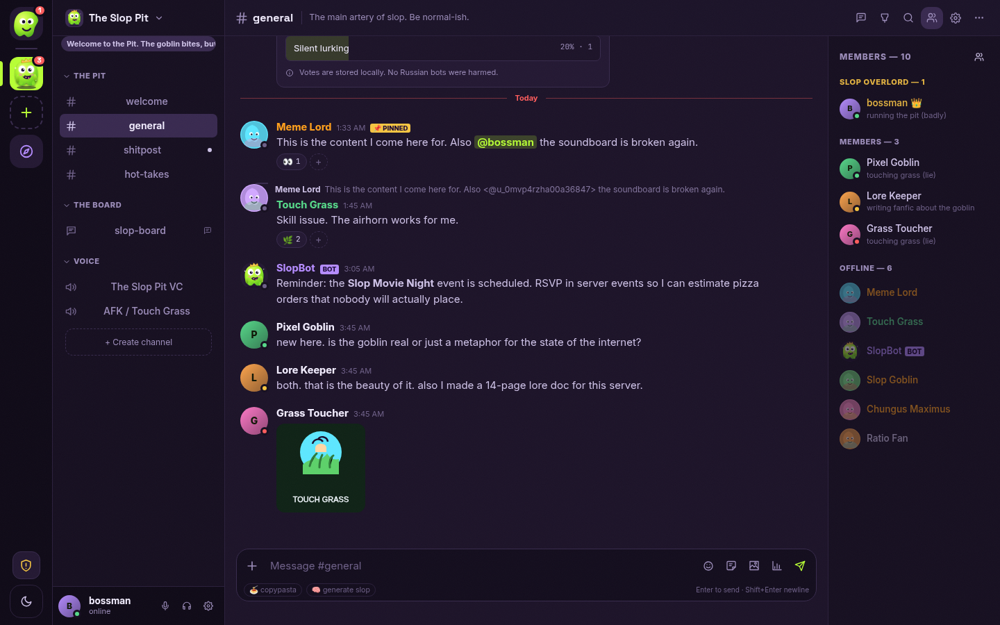

- Create, rename, reorder, lock, archive and delete channels (permission-gated).
- Slowmode, NSFW flag, topic, forum tags, default forum sort and vote toggles.
- Invites with expiry/use limits; discovery join; transfer ownership; leave/delete server.
- Server MOTD and traits appear in the channel sidebar.
- Role hoisting controls member-list groups; role colors tint names.

## Messages

| Feature | Details |
|---|---|
| Sending | Enter sends, Shift+Enter adds a newline; client rate/size validation, server limits |
| Editing | Inline edit; encrypted DMs are immutable from the UI by design |
| Deleting | Author delete, moderator delete, bulk purge by count/author |
| Replies | Quoted reply context, jump-to-message |
| Pins | Pin/unpin, pins side panel, permission-gated |
| Attachments | Up to 10 per message; images, audio, video, PDF, ZIP, text |
| Saved | Bookmark messages; saved list in the sidebar |
| Spoilers | `||spoiler||` click-to-reveal |
| Mentions | User, role and channel references; @everyone/@here where permitted |
| Typing | Ephemeral typing indicators over WebSocket |
| Markdown | Headings, lists, quotes, code blocks, inline code, links, timestamps, custom emoji |
| Meme tools | Copypasta menu, `/slop`, `/meme`, `/memepick`, `/8ball`, `/coinflip`, `/poll`, sticker picker |

Markdown is parsed into Preact VNodes. There is no `innerHTML`, no raw HTML, and no external image/link preview
fetching. Images render only from same-origin upload or bundled asset paths.

### Reactions, votes and awards

- Unicode reactions plus server custom emoji.
- Upvote/downvote any non-deleted message; score is visible and contributes to Slop Points/karma.
- Award menu with meme awards; awards render as badges with counts.
- Votes and reactions are idempotent per user and broadcast live.
- Leaderboard aggregates points; achievements are granted by server-side rules.

### Polls

`/poll` opens a poll composer. Polls support single or multiple choice, optional close time, and live aggregate
results. Votes are one per user per option and update through `POLL_UPDATE`. Results are aggregate; the UI does not
claim cryptographic anonymity.

## Threads and forums

Forums are Reddit-flavored: posts are threads with a title, tags, body, votes, replies and participants. Sorting is
`hot`, `new` or `top`. Threads can be locked or archived. Replies live in the normal message pipeline, so mentions,
attachments, reactions and moderation work inside them.

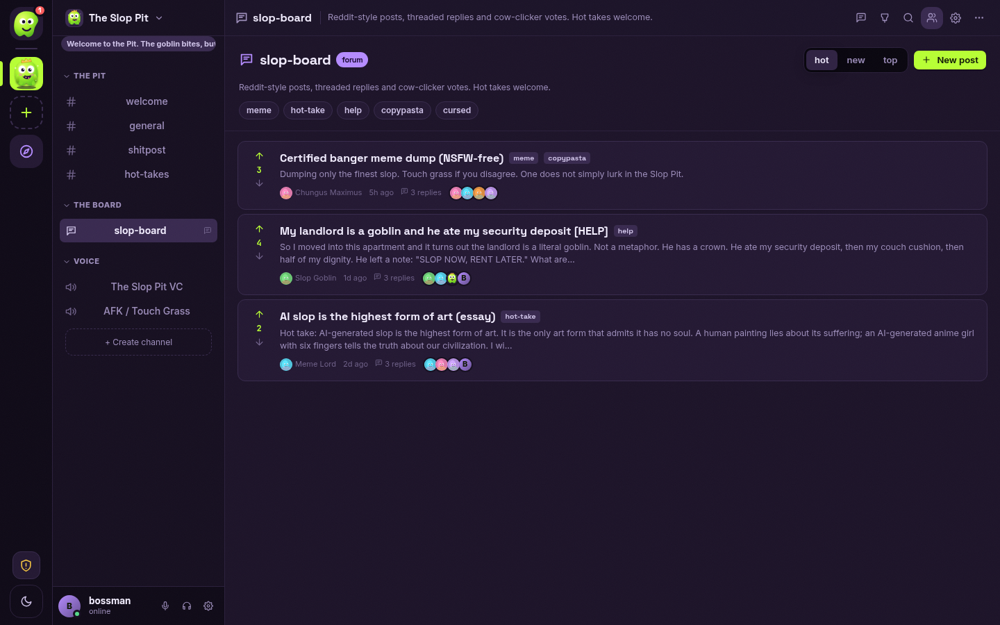

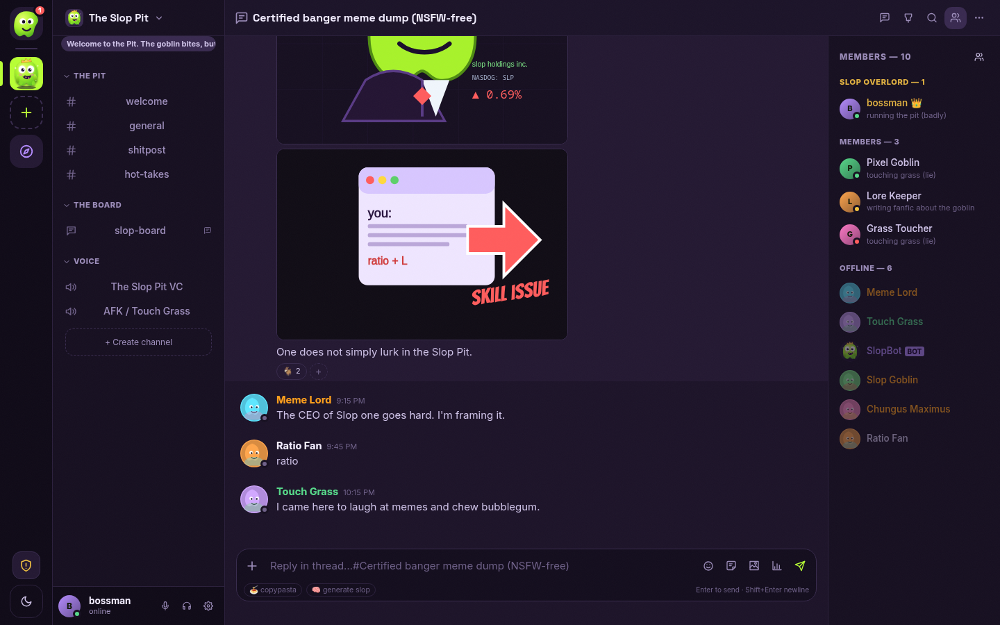

The forum card preview strips Markdown to plain text instead of leaking raw image syntax. Opening a post routes to
the real thread channel.

## Search

`Ctrl/Cmd + F` opens local FTS5 search. Scopes: current channel, current server, or everything you can read. Filters
work in the query itself:

| Operator | Example | Behavior |
|---|---|---|
| `from:` | `from:touchgrass pizza` | Restrict to a visible user's username or display name |
| `has:` | `has:image slop` | Messages with image/file/link content |
| `before:` | `before:2026-01-01 pizza` | Messages before a date or epoch milliseconds |
| `after:` | `after:2026-01-01 pizza` | Messages after a date or epoch milliseconds |

Permission checks are applied before search: private channels and foreign DMs are excluded, and encrypted DMs are
never indexed or returned.

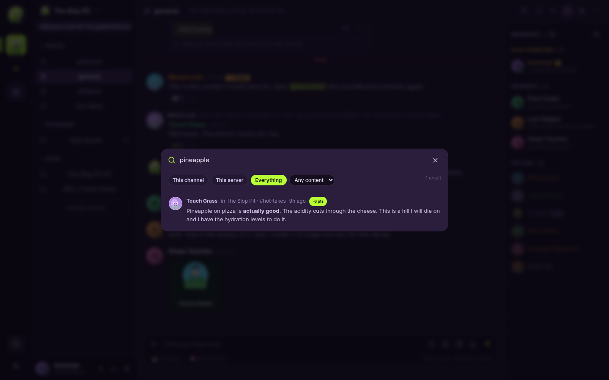

## Direct messages, friends and presence

- 1:1 and group DMs, unread counts, mentions, close/leave conversation.
- Friend requests, accept/decline/remove, user blocking (blocks also hide DMs).
- Presence: online, idle, DND, invisible/offline, custom status, multiple tabs.
- Notification inbox for mentions, friend requests, reports and moderation outcomes.
- Desktop notifications are opt-in; only while the tab is hidden and the browser grants permission.

## End-to-end encrypted DMs

1:1 DMs can be encrypted in the browser with ECDH P-256 + AES-256-GCM. The private JWK stays in `localStorage`; the
server receives ciphertext, a versioned IV/algorithm blob and an `encrypted` flag. Message edits are disabled for
encrypted messages, search excludes them, and the server cannot read them.

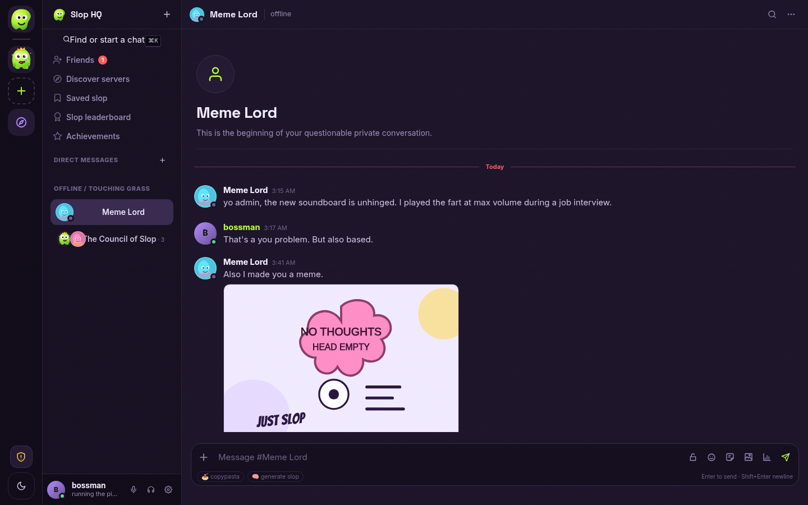

**Honest limits:** static keys, no Double Ratchet/forward secrecy, no group E2EE, no safety-number verification, and
clearing site data loses old plaintext unless you exported the private key. Attachments in DMs are not encrypted.
Read [PRIVACY.md](PRIVACY.md#e2ee-threat-model) before treating this as Signal.

## Voice

Voice channels use browser WebRTC in a peer-to-peer mesh. The server only relays authenticated SDP/ICE signaling and
tracks who is connected. Mute, deafen, speaking indicators, participant tiles and a soundboard are included.

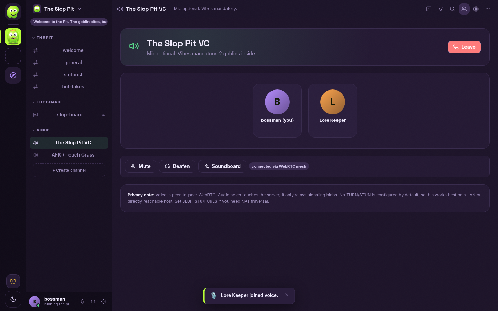

Soundboard clips are same-origin bundled audio; playback is broadcast to the voice room. Global sounds appear only
when demo seeding is enabled; server sounds are managed per server.

**Honest limits:** no TURN relay, no recording, no transcription, no server media routing, no screen sharing and no
voice calls inside DMs. Mesh topology means every participant connects to every other participant. Configure
`SLOP_STUN_URLS` for NAT traversal; symmetric NAT without TURN will fail.

## Moderation

- Kick, ban/unban, timeout with presets/custom duration, warnings.
- Channel message purge by count or author.
- Reports from users, resolution notes, global report queue for instance admins.
- Server moderation rules (regex automod) with add/delete.
- Audit log for server and instance actions.
- Role hierarchy prevents moderating equal/higher roles; owners and the last instance admin are protected.
- Every moderation mutation is audited and broadcast where relevant.

## Server settings

A full modal with tabs backed by real endpoints:

| Tab | Capabilities |
|---|---|
| Overview | Name, description, icon, banner, color, MOTD, traits, visibility, NSFW, welcome/system channels |
| Roles | Create/edit/delete, permission matrix, presets, color/hoist/mentionable, position ordering |
| Channels | Create/edit/reorder/delete; type, tags, slowmode, lock, votes, parent category, tri-state role/user allow/deny overrides |
| Members | Search, nicknames, roles, timeout, kick, ban, hierarchy checks |
| Invites | Create/revoke server invites, copy codes |
| Emojis & assets | Emoji, stickers, sounds with uploads |
| Events | Create/edit/delete events, cover image, RSVP |
| Webhooks | Create/revoke; one-time token shown once; external POST endpoint |
| Moderation | Reports, warnings, automod rules, audit shortcuts |
| Audit log | Filterable server audit trail |
| Danger zone | Transfer ownership, leave, delete server |

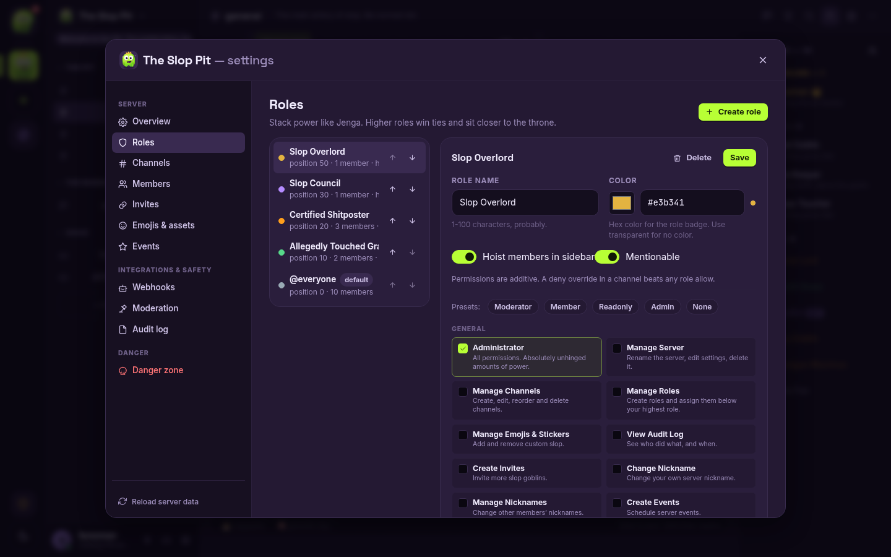

## User settings

| Tab | Capabilities |
|---|---|
| My account | Display name, avatar, banner color, bio, pronouns, custom status |
| Appearance | Five themes, compact messages, large text, reduced motion |
| Notifications | Desktop permission, mention-only mode |
| Password & 2FA | Change password (revokes other sessions), TOTP setup/enable/disable |
| Sessions | Inspect user agent/time, revoke one, revoke all others |
| Privacy & data | Export ZIP, E2EE key backup/import, hard account deletion |
| About | Version, privacy posture, runtime facts |

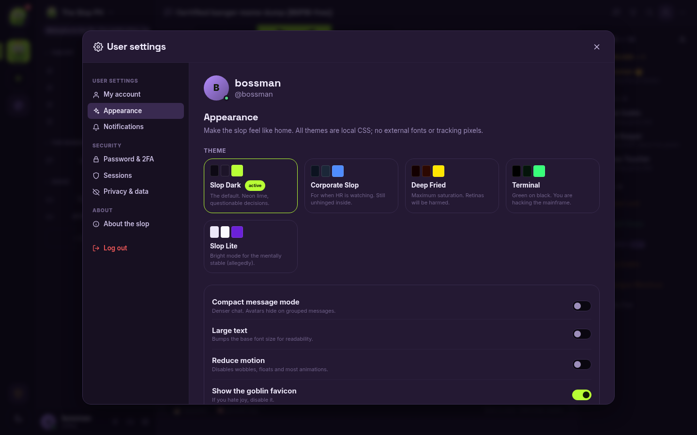

Themes: **Slop** (default neon dumpster), **Corporate Slop**, **Deep Fried**, **Terminal**, **Light**. All are local
CSS variable sets, no external fonts or assets.

## Profiles

Click any avatar or member to open a profile popover with banner, avatar, status, custom status, bio, member-since,
mutual servers, Slop Points, achievements, roles and actions (DM, friend, block). Profile views are not tracked.

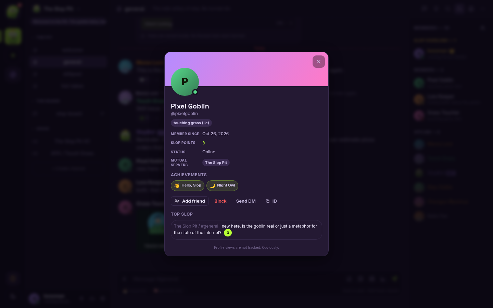

## Admin console

The admin SPA is a separate interface at `/admin`, not a modal in the chat app. Only `is_admin` accounts can enter.
It is intentionally colder and denser than the chat UI.

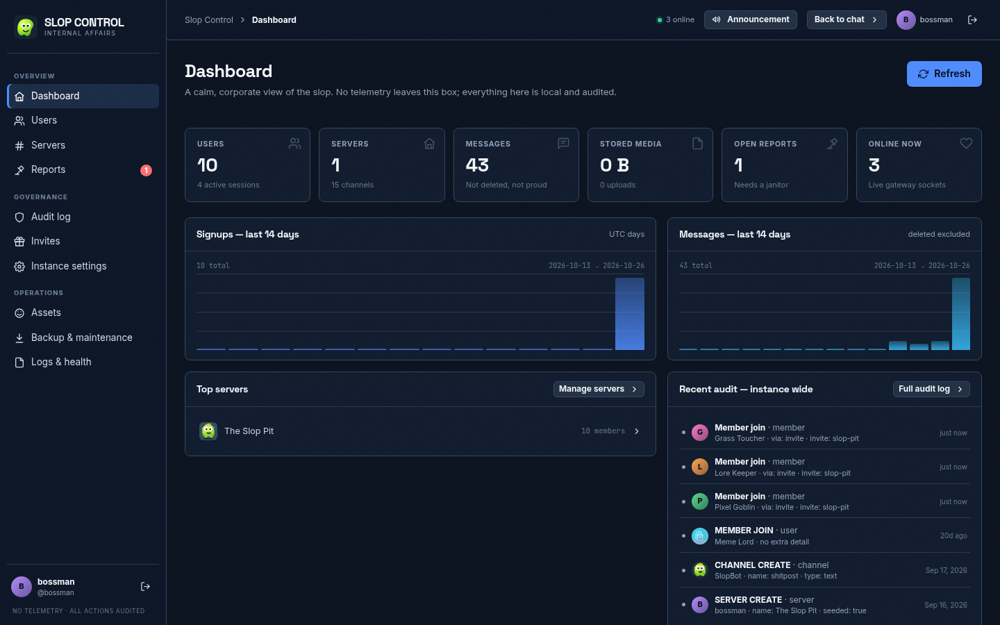

| Page | Capabilities |
|---|---|
| Dashboard | Counts, online users, storage, 14-day signup/message charts, top servers, recent audit |
| Users | Search/filter, inspect, promote/demote admin, suspend, reset password, revoke sessions, delete |
| Servers | Inspect channels/roles/members, transfer owner, close/delete server, edit admin-visible fields |
| Reports | Global queue, resolve with delete/timeout/ban/dismiss and notes |
| Audit log | Instance-wide audit trail with filters |
| Invites | Server invites and account invite codes |
| Instance settings | Name, description, MOTD, registration mode, upload limits, feature flags, meme mode |
| Assets | Instance emoji and uploaded assets, delete with safety checks |
| Backup & maintenance | Download DB/media backup, vacuum/checkpoint/cleanup tasks |
| Logs & health | DB/WAL size, memory, uptime, runtime version, recent log tail |
| Announcements | Broadcast an in-app announcement to every user |

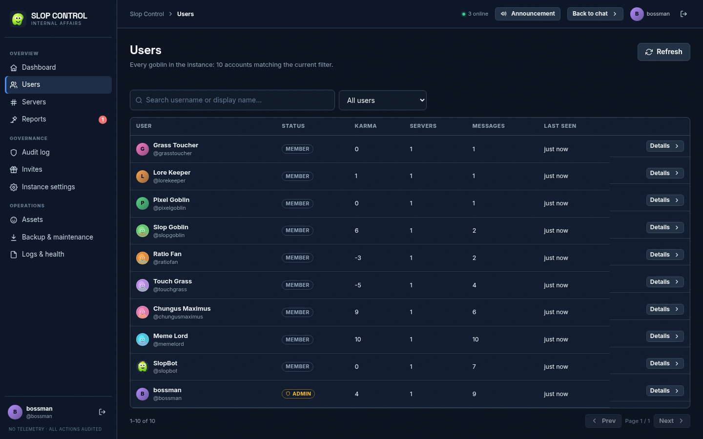

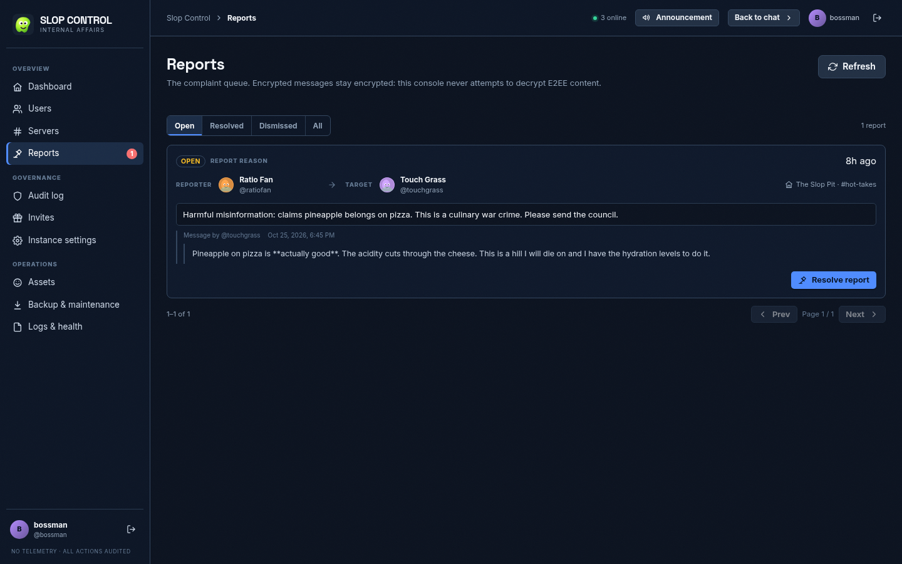

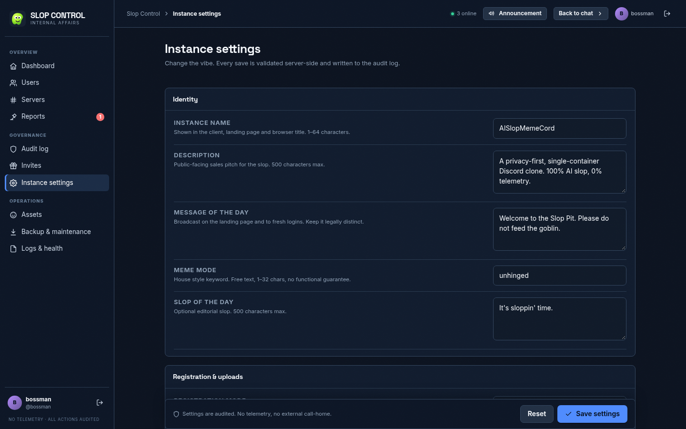

## Mobile

The SPA is responsive down to a 390 px viewport. The mobile bar opens a combined server rail + channel sidebar
drawer with a scrim; selecting a channel closes it. The member list is a separate overlay opened from the channel
header. Modals become bottom sheets.

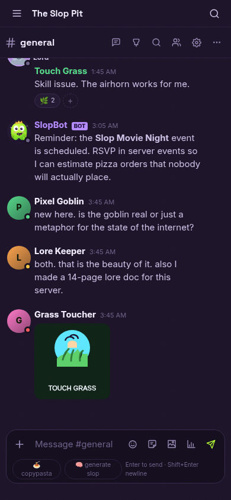

## Privacy controls

- No email, phone, OAuth or third-party identity.
- Argon2id password hashing; opaque session tokens hashed at rest.
- TOTP 2FA, per-session revoke, full logout.
- ZIP export of profile, messages, servers, friends, DMs and recent uploads.
- Hard delete with cascade, no soft-deactivated account.
- Local-only notifications; no push service.
- Strict CSP and no outbound requests, except optional STUN if configured.

See [PRIVACY.md](PRIVACY.md).

## Integration surface

- Webhooks: create in server settings, POST JSON to the generated URL; token is shown once and stored hashed.
- REST API for every surface; see [API.md](API.md).
- WebSocket gateway for messages, presence, typing and voice signaling.
- JSON import/export is not implemented; the export ZIP is a human-readable archive, not a Discord migration tool.

## Deliberately not included

These are boundaries, not a roadmap pretending to be a feature list:

- Federation, multi-node scaling or shared Redis.
- Native apps, bot marketplace, app directory, monetization/Nitro, ads.
- Email, SMS, push, OAuth or third-party identity.
- Group E2EE, key transparency/safety numbers, forward secrecy, encrypted attachments.
- Screen sharing, voice/video calls in DMs, TURN relay, recording, transcription.
- External link previews, Gravatar, CDNs, third-party fonts, telemetry.
- Discord data import.
- Automatic EXIF stripping (remove metadata before uploading sensitive photos).

## Comparison in one table

| Capability | AISlopMemeCord | Discord | Matrix | Signal |
|---|---|---|---|---|
| Self-hosted single container | Yes | No | Possible, multiple services | No |
| Servers/channels/roles | Yes | Yes | Rooms/spaces, different model | No |
| Forums with votes | Yes | Partial | No native equivalent | No |
| Threads | Yes | Yes | Threads via clients | Replies |
| Voice | Mesh, no TURN | Managed SFU | Calls via add-ons | Calls |
| E2EE DMs | 1:1, static keys | No (client-side E2EE not default) | Yes, with device verification | Yes |
| Telemetry | None | Product analytics | Varies | Minimal |
| Admin web console | Yes | No self-hosted | Admin APIs, no first-party console | N/A |
| Meme density | Unreasonable | Corporate | Serious | Extremely serious |

The comparison is about deployment and feature shape, not a security or scale equivalence claim.
