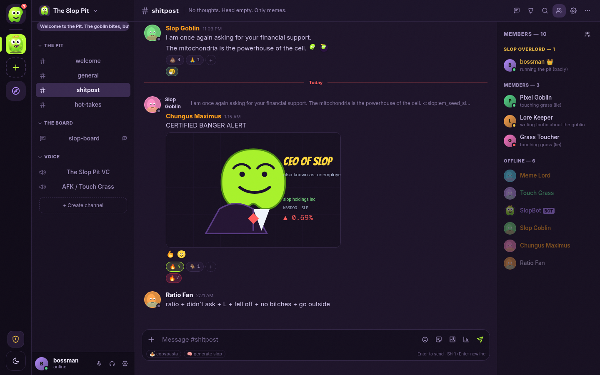

# Guided tour

> Sixteen screens, one questionable decision at a time. All screenshots are from the seeded demo instance generated
> by `bun run screenshot`, not mockups.

## 1. The front door

Landing is a two-column pitch: meme headlines, the actual privacy claims, and a registration card. No cookie banner,
no "sign in with a corporation", no newsletter popup. The first account becomes the instance admin.


## 2. Home, where the slop lives

After registering, the admin gets **The Slop Pit** and its unread notifications, friend request and meme ticker.
The left rail switches servers; the sidebar switches between home, DMs and server channels.


## 3. A real channel

Channels have topics, slowmode, pins, threads, member lists and a composer with attachments, polls, stickers,
emoji and copypasta. Messages support Markdown rendered as safe VNodes, reactions, upvotes and awards. The seeded
chat includes original SVG memes and a live poll.


## 4. Shitpost channel, the reason for the project

Forum boards, custom emoji, reactions and attachments all work in the same view. No external images; every meme is
a bundled asset or an upload from `/data`.



## 5. Forum boards

`# slop-board` behaves like a tiny Reddit: tags, hot/new/top sorting, post votes and reply counts. Cards show a
plain-text excerpt, not raw Markdown.


Opening a card enters the actual thread, with the full Markdown body and replies.


## 6. Appearance

Five self-hosted themes: Slop, Corporate Slop, Deep Fried, Terminal and Light. Compact mode, large text and reduced
motion live beside them. Themes are CSS variables, not remote stylesheets.


## 7. Server settings

Roles, permission overrides, members, invites, assets, events, webhooks, moderation, audit log and danger zone are
real tabs with real API calls. The roles tab shows hierarchy, color, hoisting and a permission matrix. Every
mutation is permission-checked server-side and audited.


## 8. Slop Control

`/admin` is a separate SPA with a colder visual language. It is not a hidden chat modal: instance admins get
dashboard charts, user administration, server inspection, a global report queue, audit logs, invite codes, instance
settings, assets, backups, maintenance, health/logs and announcements.


The users table supports search and filters; the report queue resolves reports with moderation actions.


## 9. Profiles and DMs

Clicking a member opens a profile popover with mutual servers, achievements, Slop Points and actions. DMs support
friends, blocks, group conversations and optional 1:1 E2EE.


## 10. Voice, with friends

Voice channels show participant tiles, mute/deafen/speaking state and a soundboard. The screenshot below has two
real browser clients connected over the WebRTC mesh. The server only relayed signaling.


## 11. Mobile

At 390 px the app becomes a single-column chat with a bottom-sheet composer. The hamburger opens the combined
server/channel drawer; the member list is a separate overlay.


## 12. Search

Local FTS5 search with channel/server/all scopes and `from:`, `has:`, `before:` and `after:` operators. Results link
back to the original message. Nothing leaves the instance.


## Regenerating these images

```bash
bun install
bun run screenshot
```

The script builds the app, starts a throwaway in-process server on an ephemeral port, registers the admin and three
extra users, opens real browser contexts (including WebRTC with fake media devices), exercises the surfaces above,
and writes all twenty PNGs into `screenshots/`. It fails on console errors or missing UI so stale/broken shots do
not silently ship. Set `SLOP_CHROMIUM` if Chromium is not at one of the standard locations.

Every image in the folder is listed with a caption in [`screenshots/README.md`](../screenshots/README.md).
